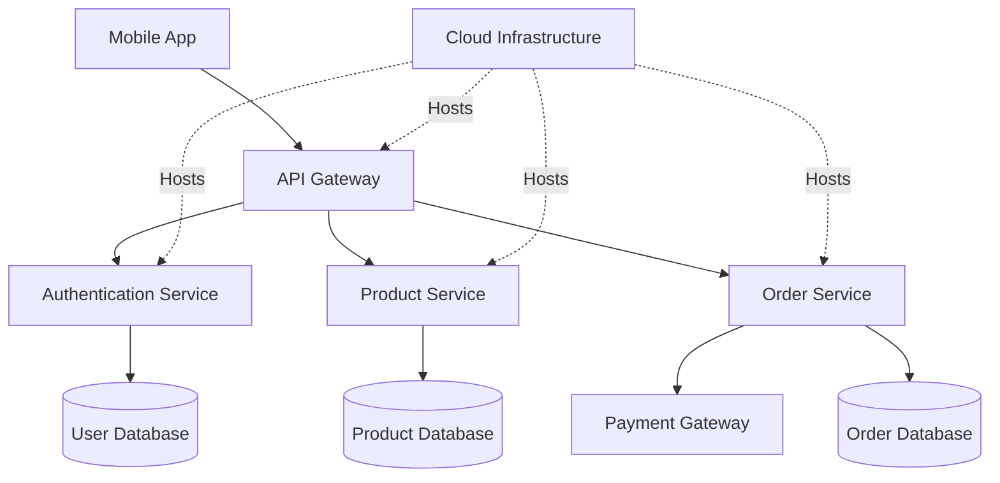

# E-commerce System Design

## Components
- Mobile App: User interface.
- API Gateway: Routes requests.
- Authentication: Verifies users.
- Product Service: Manages products.
- Order Service: Processes orders.
- Payment Gateway: Processes payments.
- Databases: Store application data.
- Cloud: Hosts application services.
