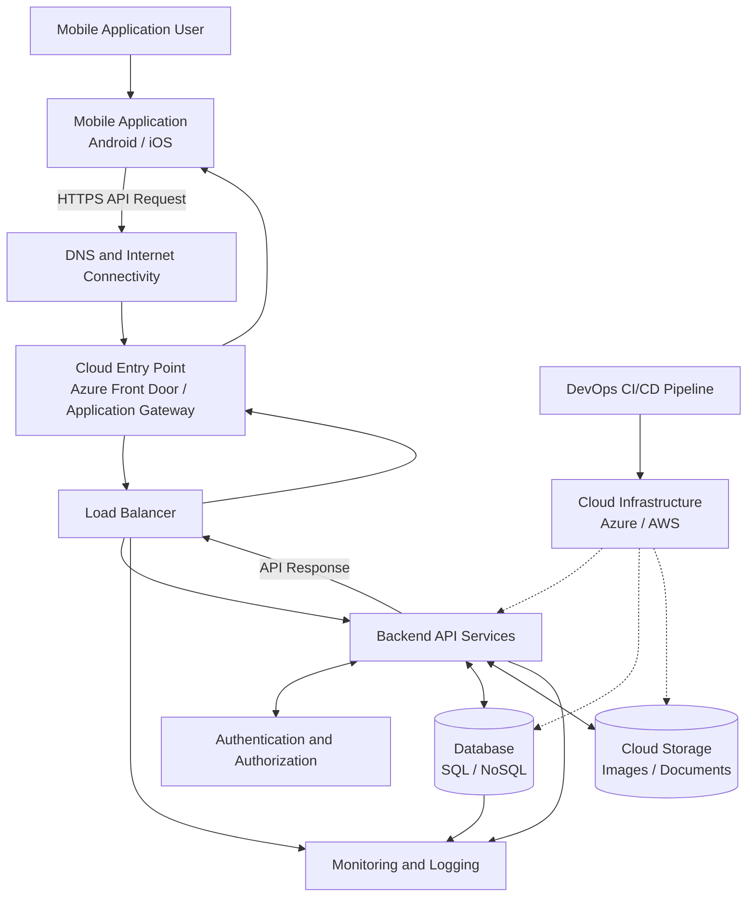

# Mobile Application Architecture

## 1. Objective

Design a high-level architecture for a modern mobile application and understand how its client, backend, APIs, databases, security services, load balancers, and cloud infrastructure work together.

## 2. Architecture Overview

The architecture follows a client-server model. The mobile application communicates with backend services through secure HTTPS APIs. Backend services process requests, validate users, and interact with databases and storage services.

## 3. Mobile Application Architecture Diagram

## 4. Architecture Layers

### Client Layer
The mobile application provides the user interface and allows users to interact with application features.

### Communication Layer
HTTPS and APIs enable secure communication between the mobile application and backend services.

### Application Layer
Backend services process business logic, validate requests, authenticate users, and coordinate database operations.

### Data Layer
Databases store structured application information, while cloud storage maintains files, images, and documents.

### Infrastructure Layer
Cloud services provide compute, networking, storage, load balancing, security, and monitoring resources.

### Operations Layer
DevOps practices automate application deployment, infrastructure provisioning, monitoring, and maintenance.

## 5. Architecture Workflow

1. The user interacts with the mobile application.
2. The mobile application sends an HTTPS request to a backend API.
3. Cloud networking routes the request through the configured entry point.
4. A load balancer directs the request to a healthy backend server.
5. Backend services authenticate and authorize the request.
6. The backend retrieves or updates information in the database or cloud storage.
7. The backend generates an API response, commonly in JSON format.
8. The response travels back to the mobile application.
9. The mobile application displays the result to the user.
10. Monitoring services collect operational metrics and logs.

## 6. Security Considerations

- Use HTTPS and TLS to protect data in transit.
- Authenticate users before allowing access to protected resources.
- Apply authorization and least-privilege access controls.
- Store secrets and credentials in secure secret-management services.
- Validate API inputs and protect sensitive application data.
- Configure database access securely.
- Monitor suspicious activities and application errors.

## 7. Scalability and Availability

- Use load balancing to distribute incoming traffic.
- Scale backend services according to application demand.
- Configure health checks to detect unhealthy services.
- Maintain database backups and recovery procedures.
- Use monitoring and alerts to identify service failures.

## 8. DevOps Responsibilities

- Maintain source code repositories and version control.
- Automate builds, testing, and deployment through CI/CD.
- Provision cloud infrastructure using Infrastructure as Code.
- Manage containers and application environments.
- Secure deployment credentials and cloud resources.
- Monitor infrastructure health and application performance.
- Maintain backups, disaster recovery, and release procedures.

## 9. Conclusion

A mobile application depends on multiple interconnected components. The mobile client communicates with backend APIs, backend services process requests, databases store information, and cloud infrastructure provides the resources needed to operate the system. DevOps practices support secure deployment, automation, monitoring, scalability, and reliability.
