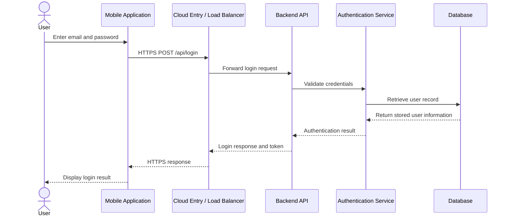

# Mobile Application Request-Response Flow

## 1. Objective

Understand the complete sequence of communication between a mobile application, backend API, authentication service, and database using a practical example.

## 2. Scenario: User Login in a Shopping Application

A user opens a mobile shopping application and enters an email address and password. The application sends the login request to the backend server. The backend verifies the credentials and returns the appropriate response.

## 3. Request-Response Flow Diagram



## 4. Detailed Request-Response Steps

### Step 1: User Action
The user opens the mobile application and enters login credentials.

### Step 2: Mobile Request
The mobile application prepares an HTTP POST request and sends it securely using HTTPS.

Example endpoint:

POST /api/login

Example request body:

```json
{
  "email": "user@example.com",
  "password": "example-password"
}
```

This is illustrative sample data, not a real account.

### Step 3: Traffic Routing
The cloud entry point and load balancer route the incoming request to an available backend service.

### Step 4: Backend Processing
The backend receives the request, validates its structure, and forwards the credentials for authentication.

### Step 5: Authentication
The authentication service verifies the supplied credentials against securely stored password hashes.

### Step 6: Database Interaction
The backend or authentication service retrieves the required user record from the database.

### Step 7: Server Response
If authentication succeeds, the backend can return a success response and an appropriate authentication token.

Example successful response:

```json
{
  "status": "success",
  "message": "Login successful",
  "accessToken": "<example-access-token>"
}
```

If authentication fails, the server returns an appropriate error response without exposing sensitive information.

Example failure response:

```json
{
  "status": "error",
  "message": "Invalid email or password"
}
```

### Step 8: Mobile Application Displays Result
The mobile application processes the response and displays the dashboard or a login error message.

### Step 9: Subsequent API Requests
For protected operations, the mobile application sends the access token according to the backend authentication design. The backend validates the token and checks the user's permissions before allowing access.

## 5. Other Examples of Mobile API Requests

| User action | HTTP method | Example endpoint |
|---|---|---|
| View products | GET | /api/products |
| Register account | POST | /api/users |
| Place order | POST | /api/orders |
| Update profile | PATCH | /api/users/101 |
| Delete address | DELETE | /api/addresses/5 |

## 6. Common HTTP Response Codes

| Status code | Meaning |
|---|---|
| 200 | Request completed successfully |
| 201 | Resource created successfully |
| 400 | Invalid request |
| 401 | Authentication required or invalid |
| 403 | Access forbidden |
| 404 | Resource not found |
| 500 | Internal server error |
| 503 | Service unavailable |

## 7. Error Handling and Reliability

- Validate request data before processing.
- Use meaningful HTTP status codes.
- Avoid returning passwords, secrets, or sensitive internal details.
- Handle network timeouts and connection failures.
- Implement suitable retry logic for transient failures.
- Monitor API errors and response times.
- Use health checks and load balancing to improve service availability.

## 8. DevOps Responsibilities in This Flow

1. Deploy backend APIs using automated CI/CD pipelines.
2. Maintain HTTPS certificates and secure network configurations.
3. Monitor API availability, latency, and error rates.
4. Manage database backups and recovery.
5. Protect application secrets and service credentials.
6. Configure cloud infrastructure and traffic routing.
7. Investigate failures using application logs and monitoring tools.

## 9. Conclusion

A mobile application request travels through secure network communication to backend services. The backend processes the request, interacts with authentication services and databases, and returns a structured response. DevOps practices support secure deployment, monitoring, availability, and reliable operation of this complete flow.
