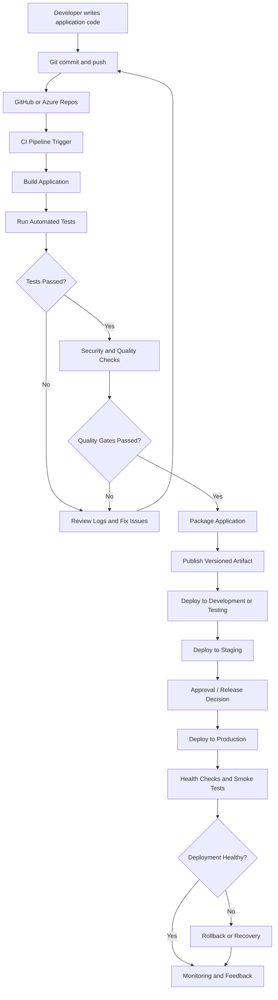

# Basic CI/CD Pipeline Diagram

This diagram represents a simplified software delivery workflow from source-code changes through deployment and monitoring.

## Diagram Explanation

1. Developer changes application code and pushes it to the repository.
2. The pipeline starts based on its configured trigger.
3. The build stage prepares the application.
4. Automated tests validate functionality.
5. Security and quality checks validate the release.
6. The application is packaged and stored as a versioned artifact.
7. The artifact is deployed to the required environments.
8. Production deployment may require approval.
9. Health checks validate the deployment.
10. Monitoring collects feedback and identifies issues.

A failed build or test stops the pipeline from progressing through the required gates. A failed production health check can trigger recovery or rollback according to the release strategy.
