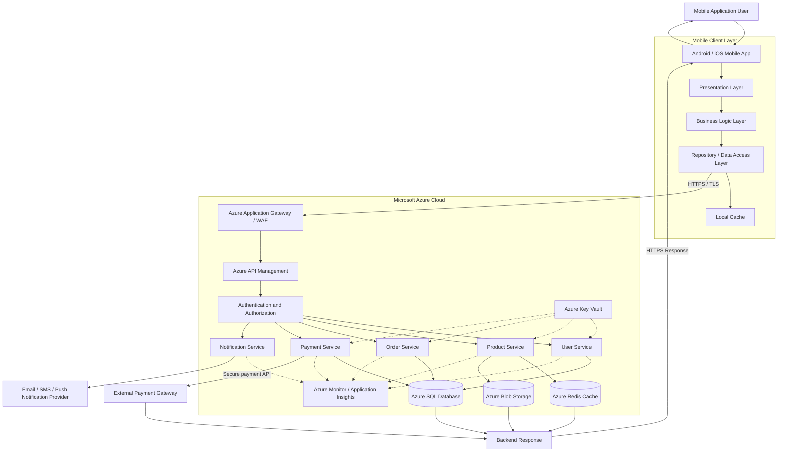

# Updated Mobile Application Architecture

## Architecture Overview

This architecture represents a cloud-based mobile application using Azure services.
The mobile client communicates securely with backend APIs, which process requests
and access databases, storage, and external services.

## Architecture Diagram

## Architecture Components

1. **Mobile Client:** Android and iOS application used by customers.
2. **Presentation Layer:** Displays screens, forms, and application data.
3. **Business Logic Layer:** Handles client-side validation and application rules.
4. **Repository Layer:** Coordinates API communication and data access.
5. **Local Cache:** Stores selected data locally for faster access.
6. **Application Gateway / WAF:** Provides application-level routing and web traffic protection.
7. **API Management:** Manages API access, routing, policies, and rate limits.
8. **Authentication:** Verifies user identity and permissions.
9. **Backend Services:** Handle user, product, order, payment, and notification operations.
10. **Azure SQL Database:** Stores structured transactional information.
11. **Redis Cache:** Improves access speed for frequently requested data.
12. **Blob Storage:** Stores product images and other files.
13. **Key Vault:** Protects application secrets and credentials.
14. **Azure Monitor / Application Insights:** Collects logs, metrics, and application telemetry.
15. **External Providers:** Support payment processing and customer notifications.

## Request-Response Flow

1. The user performs an action in the Android or iOS application.
2. The mobile client sends an HTTPS request to the cloud endpoint.
3. Application Gateway and WAF inspect and route incoming traffic.
4. API Management applies API policies and forwards the request.
5. Authentication and authorization validate the request.
6. The appropriate backend microservice processes the business operation.
7. The service reads or writes data using Azure SQL, Redis Cache, or Blob Storage.
8. External payment or notification providers are contacted when required.
9. The backend returns the response through the API layer.
10. The mobile application displays the result to the user.

## Security and Reliability

- Use HTTPS with TLS to protect data in transit.
- Apply authentication and authorization to protected APIs.
- Store secrets in Azure Key Vault.
- Apply API rate limits and gateway security policies.
- Monitor application health, errors, and performance.
- Use database backups and appropriate recovery procedures.
